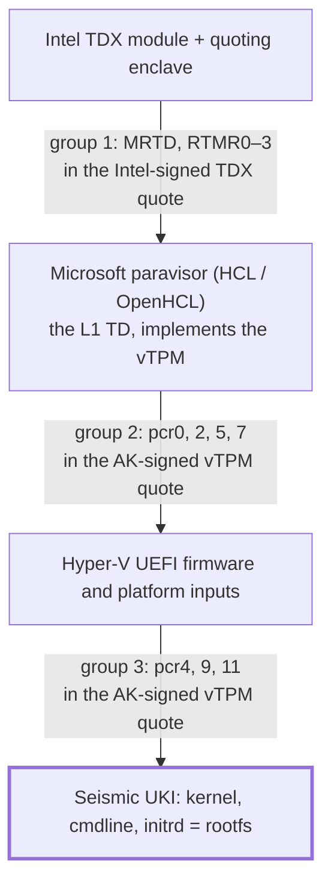
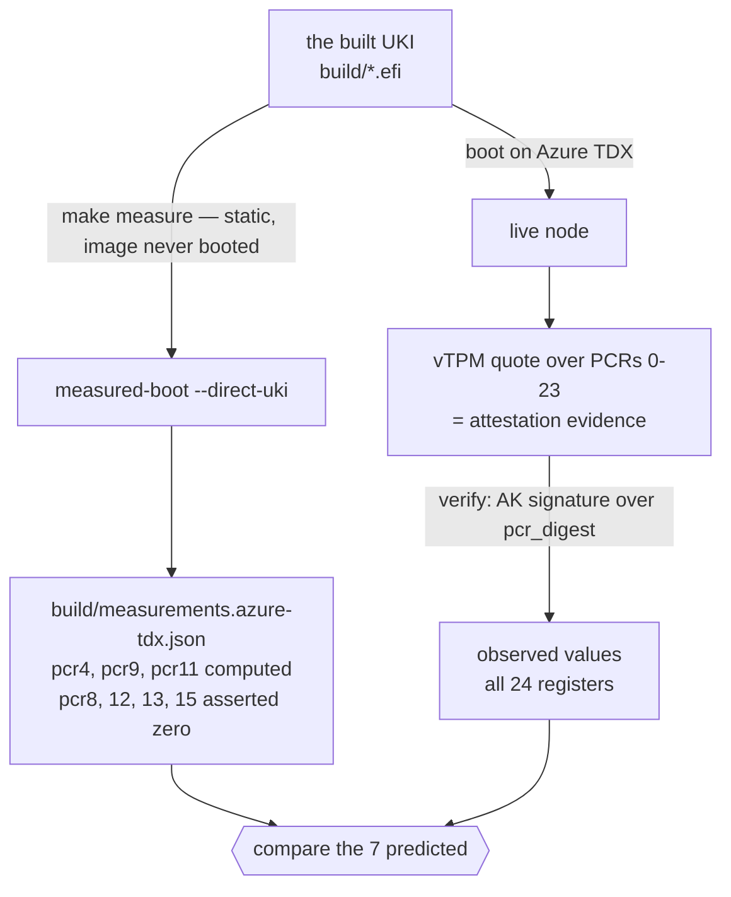

# Azure guest measurements

A Seismic node's guest identity on Azure TDX is the tuple
**`(pcr4, pcr9, pcr11)`**. This document is the empirical basis for that
choice: what a node's boot measures, what each register covers, and why the
other 21 registers stay out. The boot path it describes is the one this repo
builds — [`shared/`](../shared/) plus [`modules/seismic/`](../modules/seismic/)
plus the selected profile. The normative rules that consume it — the
schema, admission-ID derivation, and registry storage — are in the
[measurement-admission specification](https://github.com/SeismicSystems/enclave/blob/seismic/crates/measurement-admission/SPEC.md),
and how a network pins its first policy document is in
[network founding](https://github.com/SeismicSystems/seismic/blob/main/docs/tee/network-founding.md).

Scope: the Azure TDX + vTPM backend. A different attestation backend (bare
TDX RTMRs, GCP) measures different things and gets its own schema.

Every value here is per build, captured 2026-07-27 from a devtools-profile
image booted as a single root-key genesis node. Devtools adds
`openssh-server`, a serial console, and `ssh.service`, so its initrd differs
from a production image: the structural conclusions carry over between
profiles, the numbers do not.

## Three groups of measurements

An Azure TDX quote carries three groups of measurements, each covering a
different layer and controlled by a different party. Only the last is
Seismic's:



| Group | Registers         | Measures                                         | Controlled by | Pinned |
| ----- | ----------------- | ------------------------------------------------ | ------------- | ------ |
| 1     | MRTD, RTMR0–3     | The paravisor                                    | Microsoft     | no     |
| 2     | pcr0, 2, 5, 7     | The guest's UEFI firmware and its inputs         | Microsoft     | no     |
| 3     | pcr4, 9, 11       | The Seismic image                                | Seismic       | yes    |

The chain that ties them together is checked by the
[`attest` Azure verifier](https://github.com/Easy-TEE/attest/blob/main/crates/verify/src/azure/mod.rs):

1. The TDX quote is genuine and at an acceptable TCB (Intel's PCS
   collateral).
2. Its `report_data` binds the HCL report, whose `var_data` carries the
   vTPM attestation key (AK).
3. The AK certificate chains to Microsoft's roots.
4. The vTPM quote is signed by that AK, and its PCRs are compared against
   the policy.

Groups 1 and 2 are left unpinned because Microsoft publishes nothing a
verifier could check them against, not because of a choice made here.
Google does publish such data for the equivalent GCP layer. The sections
below give the evidence, as of 2026-10-30.

### Group 1: MRTD and RTMR0–3 measure the paravisor

On Azure TDX the guest is not the TD. The TD Intel quotes is Microsoft's
paravisor, which runs the guest above it and implements its vTPM. MRTD is
the paravisor's initial image, and RTMR0–3 are whatever the paravisor
extends. The guest's own boot goes to vTPM PCRs instead (groups 2 and 3).

These can't be pinned:

- **No published reference values.** Microsoft publishes no MRTD for any
  paravisor build. Microsoft Azure Attestation (MAA) returns `tdx_mrtd` and
  `x-ms-compliance-status: azure-compliant-cvm`
  ([token examples](https://learn.microsoft.com/en-us/azure/attestation/attestation-token-examples)),
  but doesn't document which MRTDs it accepts. The
  [guest attestation FAQ](https://github.com/Azure/confidential-computing-cvm-guest-attestation/blob/main/cvm-guest-attestation.md)
  defines "compliant" only for SEV-SNP, as a platform version "Microsoft
  deems healthy".
- **Not reproducible.** OpenHCL is open source
  ([microsoft/openvmm](https://github.com/microsoft/openvmm)), but
  reproducible builds are unsupported
  ([openvmm#181](https://github.com/microsoft/openvmm/issues/181), still
  open), and an attempt to reproduce Azure's MRTD from source failed
  ([openvmm#2247](https://github.com/microsoft/openvmm/issues/2247)). Nothing
  says which build Azure is running.
- **No signer identity in the quote.** MRCONFIGID, MROWNER and
  MROWNERCONFIG are zero. Azure SEV-SNP has `idkeydigest`, the hash of the
  key that signs the paravisor image, which Microsoft recommends pinning
  instead of the launch measurement and describes as stable for a year. TDX
  has no equivalent field.
- **An observed-value allowlist would break admissions.** Microsoft updates
  the paravisor on its own schedule. Each rollout would make every node
  unadmittable until the list caught up.

Trust in the paravisor therefore rests on Microsoft's AK certificate chain
(step 3 above), not on a measurement.

What a Seismic node's TD report actually holds, captured 2026-10-30 from a
devtools devnet node:

| Field                              | Value                                    |
| ---------------------------------- | ---------------------------------------- |
| MRTD                               | `efef2faf…cde55e4c`                      |
| RTMR0–3                            | all zero                                 |
| MRCONFIGID, MROWNER, MROWNERCONFIG | all zero                                 |
| ATTRIBUTES                         | `0x10000000`: SEPT_VE_DISABLE, not DEBUG |

The all-zero RTMRs match MAA's sample token and third-party reports: the
paravisor measures into the vTPM, not the RTMRs. The all-zero owner fields
confirm the quote carries no signer identity.

dcap-qvl's default verifier, which the `attest` Azure path uses, already
rejects a DEBUG TD and requires SEPT_VE_DISABLE, so those attributes are
enforced today.

The report was read from the vTPM's HCL report (NV index `0x01400001`),
which embeds the TD report the quote is built from. In that blob, TDINFO
starts at byte 544 (MRTD at 560, RTMR0 at 752), following `az-cvm-vtpm`'s
`AttestationReport` and `TdReport` layouts.

### Group 2: pcr0, 2, 5, 7 measure the guest's firmware and its inputs

This is the Azure counterpart of GCP's MRTD and RTMR0: the firmware the
guest boots and the platform inputs it measures. Per the
[TCG PC Client Platform Firmware Profile](https://trustedcomputinggroup.org/resource/pc-client-specific-platform-firmware-profile-specification/):

| Reg  | Covers                                                    |
| ---- | --------------------------------------------------------- |
| pcr0 | Firmware code: Hyper-V UEFI and embedded option ROMs      |
| pcr2 | UEFI driver and application code                          |
| pcr5 | Boot manager configuration and data, including the GPT    |
| pcr7 | SecureBoot state and the db/dbx/KEK/PK it booted under    |

On GCP the same layer can be checked:

- Google publishes signed endorsements of its TD firmware, keyed by MRTD
  and chaining to `GCE-cc-tcb-root`.
- RTMR0 is reconstructed from the firmware plus the attester's platform
  metadata (RAM size, ACPI table hashes, disk count).

On Azure neither exists:

- **No published values or endorsements.** Microsoft's
  [guest attestation design](https://learn.microsoft.com/en-us/azure/confidential-computing/guest-attestation-confidential-virtual-machines-design)
  says the firmware is covered by the hardware report, and gives no expected
  PCR values. Third-party verifiers, for example
  [Intel Trust Authority](https://docs.trustauthority.intel.com/main/articles/concept-td-integrity.html),
  have users supply values captured from known-good VMs.
- **No reconstruction.** Hyper-V UEFI is not public, so nothing like the
  GCP RTMR0 reconstruction can be built for it.
- **MAA gives verdicts, not values.** MAA's `azurevm` claims include
  `secureboot` and `x-ms-azurevm-dbvalidated` / `dbxvalidated`, which it
  derives from the event log
  ([guest attestation](https://learn.microsoft.com/en-us/azure/confidential-computing/guest-attestation-confidential-vms)).
  Using them means trusting an MAA-signed JWT and adding an online
  dependency on Microsoft. The documented example is SEV-SNP, and issuance
  for TDX is unconfirmed.
- **Pinning observed values imports platform drift,** the same objection as
  for group 1. See [pcr7 is Azure-controlled](#pcr7-is-azure-controlled)
  for what leaving pcr7 out costs.

Values on the 2026-10-30 devnet node, kept as a baseline to spot platform
drift in later captures:

| Reg  | Value               |
| ---- | ------------------- |
| pcr0 | `9b93bb10…cfc808e5` |
| pcr2 | `e374878c…75f698b5` |
| pcr5 | `96f6f8ca…f2a49b59` |
| pcr7 | `00596cc1…b515d73e` |

The same reasoning is why the attester's platform metadata (`ram_bytes`,
`num_disks`) is not used on Azure: those values exist to reconstruct RTMR0
on GCP and self-hosted TDX, and Azure has no reconstruction for them to
feed.

#### What the attester can read on Azure

Even unused, `ram_bytes` has to come from somewhere. On GCP it is the
SMBIOS total. On Azure that source is often unreadable.

Hyper-V does provide type-17 (memory device) entries. On a stock
`6.8.0-1068-azure-fde` playground VM, `dmidecode -t 17` shows three:

| Locator | Size      |
| ------- | --------- |
| M0001   | 128 MiB   |
| M0002   | 2880 MiB  |
| M0003   | 13228 MiB |

That totals 16236 MiB, with `MemTotal` at 14869 MiB, 1367 MiB (8.4%)
lower. The gap fits a confidential-VM swiotlb (about 6% of RAM) plus the
`struct page` array (about 1.6%).

Reading them per entry needs `dmi-sysfs`:

- The stock kernel builds it as a module (`CONFIG_DMI_SYSFS=m`) but ships
  it in `linux-modules-extra-<release>`, which the image doesn't install.
  So `/sys/firmware/dmi/entries` is absent, and only the root-only
  `tables/DMI` blob exists.
- With that package installed and the module loaded,
  `entries/17-{0,1,2}/raw` appear as root `0400`, and reading them as a
  non-root user fails with EACCES.

A Seismic node is in the second case, since its kernel builds the module
in (`CONFIG_DMI_SYSFS=y`), and the attestation service runs as
`User=attestation`. On the 2026-10-30 devnet node:

- `entries/17-{0,1,2}/raw` are root `0400`.
- `runuser -u attestation` gets EACCES.
- The sizes match the playground, and `MemTotal` is 14863 MiB, 1373 MiB
  (8.5%) below SMBIOS.

GCP grants the `tpm` group read access to these entries in
`setup-gcp-quote-access`; nothing does on Azure. So the attester falls back
to `MemTotal` there, which is harmless since nothing verifies the value.

### Group 3: pcr4, 9, 11 measure the Seismic image

These are the registers that move when Seismic ships a new image, and the
only ones that can be predicted from the image alone. They form the v1
tuple, described next.

## The three registers

| Reg   | Covers                                                             | Event log                                                                                                                                                                              |
| ----- | ------------------------------------------------------------------ | -------------------------------------------------------------------------------------------------------------------------------------------------------------------------------------- |
| pcr4  | Boot manager code and the EFI application it loads — the UKI binary | 4 events: `EV_EFI_ACTION` ("Calling EFI Application from Boot Option"), `EV_SEPARATOR`, "Boot Stage 1: Unified Kernel Image (UKI)" (`82b2f8cf…`), "Boot Stage 2: Linux" (`cf993177…`)  |
| pcr9  | Files loaded via LOAD_FILE2 — the cmdline and initrd actually loaded | 2 events: the kernel cmdline (`aa50cea3…`) and the initrd digest (`170cf31e…`)                                                                                                          |
| pcr11 | The UKI sections measured by `systemd-stub` — what the UKI contains  | 12 events: name and data for each of `.linux`, `.osrel`, `.cmdline`, `.initrd`, `.uname`, `.sbat`                                                                                       |

These three registers, and only these three, move when Seismic ships a new
image. The rootfs *is* the UKI's `.initrd` unpacked into tmpfs
([`Format=uki`](../shared/mkosi.conf)), so pcr11 covers the running
filesystem byte for byte.

**pcr9 and pcr11 overlap, and both are needed.** The initrd appears in both
with the *identical* digest `170cf31e…`. The cmdline appears in both with
*different* digests (`aa50cea3…` and `30a47dd0…`), because pcr9 measures the
UTF-16 string actually passed while pcr11 measures the raw section bytes.
pcr11 attests *what the UKI contains*; pcr9 attests *what was actually
loaded*. They diverge exactly when the boot path substitutes a cmdline or
initrd other than the embedded one, which is the case pcr9 exists to catch.

pcr9 cannot vary node to node by configuration: `KernelCommandLine=` is fixed
in [`shared/mkosi.conf`](../shared/mkosi.conf) and baked into the UKI, so
no per-node cmdline delivery exists.

## Predicting and observing

The same image is measured twice, by two paths that never meet until the
values are compared:



The two sides are deliberately different widths. The quote covers all 24 PCRs
— `az-cvm-vtpm`'s `VTPM_QUOTE_PCR_SLOTS` is all 24 SHA-256 slots, and
`Quote::verify_pcrs()` re-hashes the bundled values against the AK-signed
`pcr_digest`, so every register in this document is authenticated rather than
an unverified server claim.

The prediction covers 7 because that is what the tool implements today, not
because 7 is the limit. [`measured-boot`](https://github.com/flashbots/measured-boot)
(pinned to v1.2.0 in [`flake.nix`](../flake.nix)) has simulators for pcr4,
pcr9, and pcr11, and seeds a bank of seven slots — 4, 8, 9, 11, 12, 13, 15 —
so `measurements.azure-tdx.json` carries three computed values plus four that assert
nothing extended those slots. The tool prints only six to stderr; pcr8 is in
the JSON but never printed.

Eight registers are unpredictable from an image, and always will be:
pcr0/2/5/6/7 are Azure firmware and platform data, pcr1/3 hold whatever
separator the firmware emits, and pcr10 is written by IMA at runtime. None of
them exist until the image boots on a particular VM.

The other nine are not a prediction problem. pcr14/16/23 are zero and
pcr17–22 are `0xff…ff` by TPM reset semantics on any vTPM, so they are
constants a predictor could assert the same way it already asserts
pcr8/12/13/15 — which would move nine registers from "checked only against a
live quote" to "checked at build time". Nothing does that today.

```bash
# predicted, from this repo's root
make measure FILE=build/<image>.efi        # -> build/measurements.azure-tdx.json

# observed, from anywhere that can reach the node (no shell required)
cargo run -p seismic-attestation-service --example capture_measurements -- \
  --url http://<node>:7878 \
  --network-id 0x$(sha256sum network-manifest.json | cut -d' ' -f1) \
  --out-policy /tmp/observed.json

diff <(jq -S . /tmp/observed.json) <(jq -S . build/measurements.azure-tdx.json)
```

`capture_measurements` reaches the node over its attestation RPC, which needs
a live custodian — a node that has finished bootstrapping. PCRs are final long
before then, so use `seismic-attestation`'s `azure_vtpm_roundtrip` on-node to
measure a node that never got that far.

**All seven registers `make measure` predicts match the live quote exactly**:
pcr4 `3dd4d386…c7c1ed7f`, pcr9 `d7c9deb1…bf42b7c9`, pcr11
`f31b9510…e55f2ab3`, and pcr8/12/13/15 zero on both sides. This retires the
main risk in a statically predicted policy — see the pcr11 caveat under
[Not yet established](#not-yet-established).

The event log is not in the quote; only final PCR values are. Diagnosing a
mismatch needs `/sys/kernel/security/tpm0/binary_bios_measurements` from the
node, which requires a shell and so is available on a devtools-profile image
only.

## Why the other registers stay out

The full 24-register inventory, and the reason each group is excluded:

| Registers                | State                             | Why not in the tuple                                  |
| ------------------------ | --------------------------------- | ----------------------------------------------------- |
| 0, 2, 5, 7               | content-bearing                   | Azure platform layer — changes without a Seismic release, no published values ([group 2](#group-2-pcr0-2-5-7-measure-the-guests-firmware-and-its-inputs)) |
| 6                        | content-bearing                   | per-VM instance — see below                           |
| 10                       | content-bearing                   | derived from pcr0–9, per-VM instance — see below      |
| 1, 3                     | `EV_SEPARATOR` only               | informationally empty                                 |
| 8, 12, 13, 14, 15, 16, 23 | all-zero                         | nothing extended them — `make measure` asserts this for 8, 12, 13, 15 |
| 17–22                    | all-`0xff`                        | uninitialized, not measurements                       |

Register assignments for pcr0–7 follow the
[TCG PC Client Platform Firmware Profile](https://trustedcomputinggroup.org/resource/pc-client-specific-platform-firmware-profile-specification/);
pcr8–15 are bootloader and OS conventions rather than TCG-assigned.

Two traps for anything that selects registers automatically:

- **pcr1 and pcr3 are verifiably empty.** Both hold `3d458cfe…198e7969`,
  which is exactly `extend(0, sha256(00000000))` — a single `EV_SEPARATOR`
  and nothing else.
- **pcr17–22 are all-ones, which is not a measurement.** DRTM registers reset
  to `0xff…ff` rather than zero when no dynamic-root-of-trust event occurs.
  Tooling that filters for "non-zero" registers wrongly treats these as
  meaningful.

### pcr6 and pcr10 vary per VM instance

A second node, provisioned from scratch on the same image, differs from the
first in exactly **two** registers:

| Register | Node 1              | Node 2              |
| -------- | ------------------- | ------------------- |
| pcr6     | `9577f07d…b9911331` | `4d78295f…40fc7ed0` |
| pcr10    | `3614d693…8cf512ff` | `db152fa8…55f17bc2` |

Everything else, including all of pcr4, pcr9, and pcr11, is byte-identical:
**the v1 tuple is confirmed stable across nodes.**

The two that vary are one finding, not two. pcr6 ("platform-manufacturer
specific") carries per-VM-instance data on Azure. pcr10 varies *because* pcr6
does. Had either been in the tuple, **every node would compute a distinct
admission ID and no node could ever be admitted.**

### pcr10 is IMA's `boot_aggregate`, and carries nothing new

The IMA runtime measurement log holds exactly one entry:

```text
10 8961fa1e… ima-sig sha256:cdccec7bae32a5132b3e6e690ed4ffbafcca0e6f83dc9c9370ca7f4c8ca51329 boot_aggregate
```

No IMA policy measures files, so pcr10 does not vary with workload, timing, or
service-startup order. The aggregate digest is reproducible from the other
registers — `sha256(pcr0 ‖ pcr1 ‖ … ‖ pcr9) = cdccec7b…8ca51329`, verified
against the observed PCRs. Note the range is **0–9**, not the 0–7 older IMA
builds use, and that the register value (`3614d693…`) is the extension of the
log entry's template hash, not the aggregate digest itself.

So pcr10 carries no independent information, and it transitively binds the
Azure platform: pcr0/2/5/6/7 are inside the hash, so admitting on pcr10 would
pin firmware, option ROMs, GPT, manufacturer data, and SecureBoot state. An
Azure platform update that moved pcr0 would invalidate every admission ID
through a path invisible in the policy document. Recomputing the aggregate
with node 2's pcr6 yields node 2's aggregate, which is why it is per-instance.

Keep pcr10 as a diagnostic: if it changes while pcr0–9 do not, IMA or the
quote is misbehaving.

### pcr7 is Azure-controlled

pcr7 is populated, so SecureBoot state and db/dbx *are* measured on this
platform. It is out of v1 because Azure controls it: binding it would import
platform drift into the tuple, the same objection that excludes pcr10, minus
the redundancy.

SecureBoot is not enforcing on Seismic nodes, by design. The deploy
program turns it off in the VM's UEFI settings because the UKI isn't signed
by a CA Azure trusts
([`seismic_node/azure.py`](https://github.com/SeismicSystems/deploy/blob/main/tee/pulumi/seismic_node/azure.py)),
and the HCL report's runtime claims confirm `"secure-boot": false`. So pcr7
records SecureBoot as disabled, and there is no load policy for v1 to
attest. Integrity comes from measured boot instead: pcr4/pcr9/pcr11
identify exactly what booted, whatever was allowed to load.

## Not yet established

1. **Why pcr11 is not phase-extended.** `systemd-stub`/`systemd-pcrphase`
   extends pcr11 with boot-phase strings (`enter-initrd` → `leave-initrd` →
   `ready`) *after* the UKI sections are measured, which would make a
   predicted pcr11 wrong for any quote taken at steady state. It does not
   happen on this image — pcr11 at full boot still equals the
   UKI-section-only prediction — but nothing in this repo masks those units,
   so the cause is unconfirmed and a systemd bump could change it.
2. **Azure platform drift.** If any of 4/9/11 transitively embeds an
   Azure-supplied component, a platform update invalidates the whole allowlist
   and every node fails admission at once. This needs either evidence across a
   platform update, or an accepted operational risk with a deprecate/re-accept
   runbook.
3. **Stability across boots and builds.** Cross-node is confirmed above.
   Rebooting the same node and building the image a second time are the
   remaining captures. Any register that varies across those cannot stay in
   the tuple.
4. **Production-image values.** A production network's policy needs its own
   capture of the image it ships.
5. **A build-time inventory check.** A promoted policy document carries
   exactly the schema registers, because a policy matcher enforces every
   register a document lists. The remaining 21 are therefore unchecked at join
   time, and the intended place to catch a surprise is release tooling
   comparing a full 24-register capture against the inventory above, so a
   mismatch fails a build instead of a join. No such check exists yet. Two
   halves would cover it: a wider `measured-boot` bank for the nine constant
   registers, needing no node at all, and a live capture for the eight
   platform registers, which cannot be predicted.
6. **A guest-extended register for the boot config.** The tuple identifies
   the image; nothing in the quote identifies the configuration the image
   booted with — the network manifest and the reth genesis file arrive in the
   config POST, after every measured stage. `tdx-init` could extend one of
   the all-zero registers with a digest of those verbatim bytes before it
   fans them out, the way CCF hashes its security policy into `host_data`,
   so a quote taken at steady state also attests the config. pcr14 is the
   leading candidate: all-zero, unasserted by `make measure`, and not pcr16,
   which is resettable. Such a register can never join the tuple — its
   value is per network and per config, while the tuple is per image, and
   the policy document's own hash is one of the bytes it would digest — so
   it would be verified by recomputation from the network's artifacts, not
   allowlisted. It needs a `tpm` permission grant for `tdx-init` and
   sequencing against the machine-wide TPM serialization gate, and it only
   pays off once post-boot quotes are recorded somewhere a later reader can
   find them; harvest quotes predate the config POST and would carry zero.
7. **Cheap paravisor-side checks.**
   [Group 1](#group-1-mrtd-and-rtmr03-measure-the-paravisor) can be narrowed
   without pinning anything by requiring RTMR0–3 to be all-zero, as captured
   on a Seismic node. It is still observed behaviour, not documented by
   Microsoft, and the `attest` verifier does not check it.

   The HCL report's `vm-configuration` flags turned out not to help. They
   describe the VM's Azure settings, which the deploy program chooses for
   every node, not the image profile:
   - `secure-boot: false` and `console-enabled: true` on every node, because
     `seismic_node/azure.py` disables SecureBoot and enables boot
     diagnostics.
   - `tpm-persisted: false` (the non-persisted vTPM disk type).

   Pinning them would pin deploy choices, and they are claims made by the
   paravisor itself.
